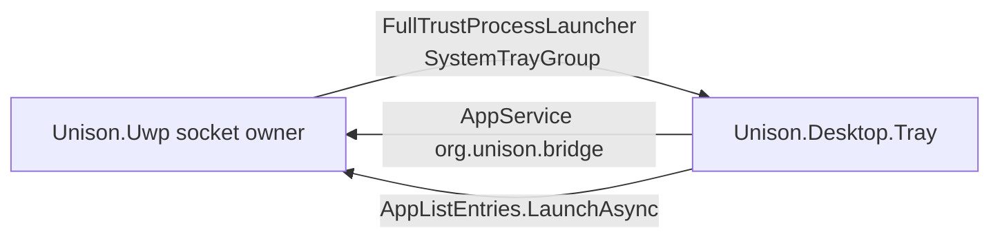

# Desktop tray

Desktop bridge aligned with [Unigram](https://github.com/UnigramDev/Unigram) (`Telegram.Stub` +
`BridgeApplicationContext`): a full-trust stub owns the notification-area icon; the UWP process
keeps the WhatsApp socket.

Mobile / store package (`Unison.Uwp`, ARM) is unchanged — no `runFullTrust`, no stub.

## How Unigram does it (and what we copy)

| Piece | Unigram | Unison |
|---|---|---|
| Stub exe | `Telegram.Stub\Telegram.Stub.exe` | `Unison.Desktop.Tray\Unison.Desktop.Tray.exe` |
| Launch | `LaunchFullTrustProcessForCurrentAppAsync("SystemTrayGroup")` | same GroupId |
| Parameters | `/SystemTray`, `/LoopbackExempt` | same |
| AppService | `org.telegram.bridge` | `org.unison.bridge` |
| Handshake | `ProcessId`, `OpenText`, `ExitText` | same keys |
| Unread | `UnreadCount` / `UnreadUnmutedCount` | same |
| Exit | ValueSet `Exit` | same |
| Close | `confirmAppClose` + `CloseRequested` | same |
| Package | one Universal + bridge | **desktop wapproj only** (Mobile stays clean) |

We keep a **separate** desktop package so ARM Mobile never ships `runFullTrust`. Unigram can put
everything in one Universal package because it no longer targets W10M.



## Start with Windows

Still on both manifests as `uap5:StartupTask` `UnisonStartup` (see Changelog). Desktop Settings
row only when `IStartupLaunchService.IsSupported`.

## Desktop package

`src/Unison.Desktop.Package` (wapproj, x64 / ARM64):

- Same Identity as `Unison.Uwp` (`Unison.UWPApp`) so it replaces the PC install and keeps data
- `runFullTrust` + `confirmAppClose`
- `windows.fullTrustProcess` with `SystemTrayGroup` / `LoopbackExemptGroup`
- In-process AppService `org.unison.bridge` → `App.OnBackgroundActivated` → `DesktopTrayHost.TryAttach`

**F5:** startup = `Unison.Desktop.Package`, platform **x64**. Deploy is on that project for
x64/ARM64; `Unison.Uwp` deploys only on ARM (Mobile).

**PRI / 0x80073B0C:** the desktop manifest must use `Assets\…` (same as UWP), not a second
`Images\` copy of scale-only logos. A NamedResource without a default/neutral candidate throws
`ResourceMap … não tem um recurso padrão ou nêutro` at launch.

If `desktop-tray|launch-skipped` shows `UnauthorizedAccessException`, uninstall the stale package
and redeploy:

```powershell
Get-AppxPackage Unison.UWPApp | Remove-AppxPackage
```

Then F5 the wapproj again. A first-chance `winrt::hresult_error` in the debugger is the WinRT
layer behind that exception — Continue (F5); the app catches it.

## Host / stub behaviour

- `DesktopTrayHost.StartAsync` → `SystemTrayGroup` (after `Window.Activate`)
- On connect: send `ProcessId`, `OpenText`, `ExitText`, then unread
- `NotificationService.UpdateBadge` → `PublishUnread`
- Tray "Sair" → `Exit` → `Application.Exit()`
- Window X (`confirmAppClose`): `CloseRequested` Handled=true + `NotifyCloseRequested(WindowId)` —
  stub hides `ApplicationFrameWindow` via Win32 (`NativeWindow`); tray "Abrir" restores it.
  Process + socket stay alive
- Stub opens with `CheckNetIsolation LoopbackExempt` (best-effort); `/LoopbackExempt` alone exits
  after that (Unigram)
