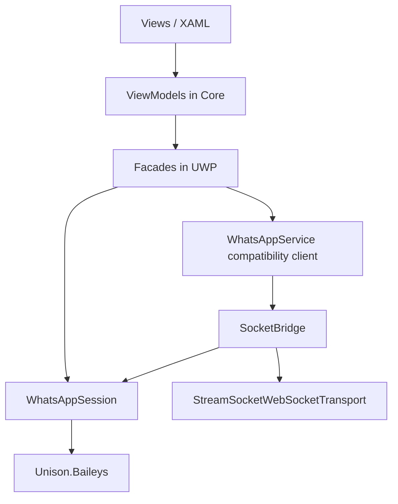
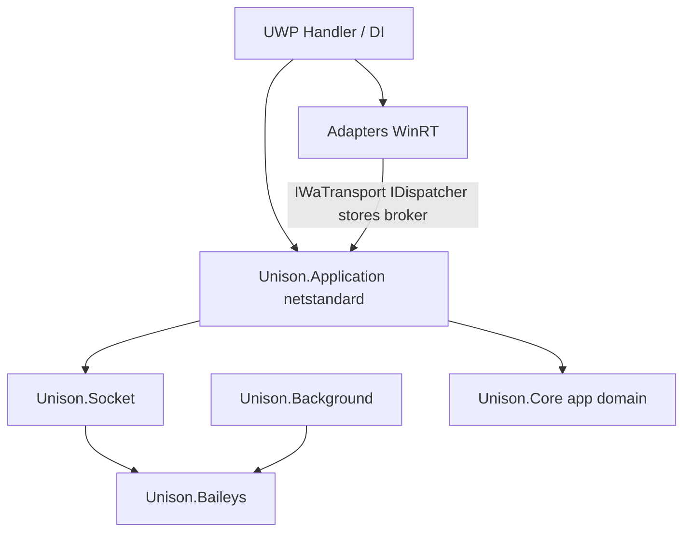

# Netstandard WhatsApp client

**Plan only.** This page describes the destination architecture and migration order. It does **not** replace [WhatsAppService extraction](WhatsAppService-Extraction): finish extracting clusters out of the compatibility client before moving types into a new project. No `src/` moves are implied by publishing this page.

Related: [Architecture](Architecture), [Application layer](Application-Layer), [Socket stack](Socket-Stack), [Background broker](Background-Broker).

---

## Name map (npm Baileys vs Unison)

`@whiskeysockets/baileys` is **one** npm package. Public entry is `makeWASocket`. Internally it mixes Socket orchestration, Utils (Noise/crypto), Signal, WABinary, WAUSync, and WAProto. Upstream also does **not** own a production chat store — an optional in-memory store binds to events; serious persistence stays in the host.

Unison split that tree into two projects. The names are easy to misread:

| Upstream Baileys | Unison project | Role |
|---|---|---|
| Crypto, Noise, binary XML, protobuf, Signal primitives, `AuthState` | **`Unison.Baileys`** | Shared leaf. No Unison project references. Used by Socket, Core, UWP, and **Background alone**. |
| `makeSocket` / `makeWASocket`, messages, groups, USync, app-state, history download, … (`Ports: rc14`) | **`Unison.Socket`** | Portable session + protocol API. This is the product surface people mean by “Baileys”. |
| App chat-list policy, UI refresh rules, SQLite/JSON persistence, People overlay | Façades + `WhatsAppService` (today in **UWP**) | Unison application layer — **not** upstream Baileys. |

Mental rename (documentation only; do not rename projects in this plan):

- `Unison.Baileys` ≈ “WA protocol primitives”
- `Unison.Socket` ≈ “Baileys” / `makeWASocket`
- New Application project ≈ TDLib-style policy API over Socket

---

## Current state

| Piece | Location | Portable? |
|---|---|---|
| Contracts (`IMessageService`, …), ViewModels, shared state helpers | `Unison.Core` | Yes (`netstandard2.0`) |
| Session, use cases, `IWaTransport` | `Unison.Socket` | Yes |
| Noise / Signal / proto | `Unison.Baileys` | Yes |
| Facades, `WhatsAppService`, `SocketBridge` | `Unison.Uwp` | No — still mixed with WinRT |
| `StreamSocket` / broker transfer | `Unison.Uwp/Transport` | No — stays behind `IWaTransport` |
| Background decode + toasts | `Unison.Background` → Baileys only | Must stay free of Core / Socket / Application |

`IWaTransport` ([`src/Unison.Socket/Abstractions/IWaTransport.cs`](../../src/Unison.Socket/Abstractions/IWaTransport.cs)) is a **behaviour port** (connect / send / close / `TransferToBrokerAsync` / `ReclaimFromBrokerAsync`), not a DTO of WinRT handles. The UWP concrete type (`StreamSocketWebSocketTransport`) keeps `StreamSocket` private. Domain code must never take `StreamSocket` in a constructor.

Platform contracts already exist in Core for several host concerns (`IDispatcher`, `ILocalSettings`, `IChatStore`, `ISocketBrokerService`, …). Gaps that still touch `Windows.*` inside façades or the client are called out in the extraction wiki and must close behind those ports before a package move.

---

## Target architecture

Style: TDLib-like — the UWP **handler** (composition root) creates WinRT adapters; a portable **Application** library receives ports and owns façades / policy; protocol stays in Socket + Baileys.

| Stays in UWP | Moves to `Unison.Application` (`netstandard2.0`) | Stays in Socket / Baileys |
|---|---|---|
| XAML, shell, `App.ConfigureServices` | Facades (`ConnectionFacade`, `MessageFacade`, …) | `WhatsAppSession`, use cases, modules |
| `StreamSocketWebSocketTransport`, `MessageWebSocketTransport`, `WaTransportAdapter` | Policy helpers today under `Services/WhatsApp/` (once WinRT-free) | Noise, Signal, binary, proto |
| SQLite / file store implementations | **Domain helpers** now parked in `Unison.Core/Helpers` because they were pure (usync filing, outgoing send, incoming timeline, history decisions, group apply, …) — same package as the façades they serve | — |
| People / contacts WinRT, toasts, tiles, broker task registration | Orchestration that today still lives in `WhatsAppService` partials after extraction | — |
| Transport **factory** + broker readiness | Calls `IWaTransport.TransferToBrokerAsync` / reclaim via session — never owns `StreamSocket` | `IWaTransport` definition |

### Core vs Application (helpers)

During extraction, pure rules left UWP for `Unison.Core` only because Core was already `netstandard`. That made Core a **purity dump**, not a deliberate app-domain boundary.

Target split:

| `Unison.Core` (app domain) | `Unison.Application` (WhatsApp client policy) |
|---|---|
| Contracts, models, ViewModels | Facades + their auxiliary services |
| **Presentation** helpers only (`RelayCommand`, bubble/link layout, UI formatting, …) | **Domain** helpers that implement façade policy (moved out of Core) |
| ViewModels talk to façade **contracts**, not to domain helpers | Owns the rules that today sit under `Core/Helpers/Chats|Messages|Contacts|History|Groups|…` when those are client policy |

Do **not** move the entire `Helpers` tree in one dump. Move **with the owning façade** in phase C. Where a ViewModel still calls a domain helper, cut that call so the VM goes through `IMessageService` / `IChatService` / … first; then the helper can leave Core.

Baileys (+ Socket) stay the protocol stack — separate from this app-domain Core.

**Fixed decisions**

1. Do **not** merge façades into `Unison.Baileys` (Background must keep a thin leaf).
2. Do **not** merge Socket + Baileys into one project in this refactor (optional NuGet packaging / rename is a later note only).
3. Do **not** stand up a second parallel client beside `WhatsAppService` — shrink and move.
4. Inject **ports** (`IWaTransport`, factory, `IDispatcher`, stores), not WinRT types, into Application.
5. [WhatsAppService extraction](WhatsAppService-Extraction) phases 3 → 4 remain the mechanical prerequisite before moving types into `Unison.Application`.
6. Core keeps **presentation** helpers; **domain** helpers leave Core for Application alongside façades.

### UWP handler

Single composition root (today: `App.ConfigureServices`, optionally a named `UwpWhatsAppHost` later):

- `new` / resolve adapters only here (`ITransportFactory` → `StreamSocketWebSocketTransport`, stores, dispatcher attach).
- Register Application façades against Core contracts.
- No new domain policy in the handler.

---

## Migration phases

Do in order. Each phase has a done check.

### Phase A — Close WinRT leaks behind existing ports

- Goal: façades and remaining client code call only Core/Socket abstractions for UI thread, settings, files, connectivity where already modelled.
- Touch: façade files under `src/Unison.Uwp/Services/WhatsApp/` that still `using Windows.*` (e.g. `ContactFacade`, `ConnectionFacade`, media path helpers).
- Done when: no new WinRT types are required on the façade public surface; remaining WinRT is only in adapters/stores/transport.

### Phase B — Finish WhatsAppService extraction (phases 3 and 4)

- Follow [WhatsAppService-Extraction](WhatsAppService-Extraction): move remaining clusters; then connection-only client (`Initialize` / connect / resume / suspend / broker / shutdown).
- Done when: ViewModels and façades do not need the god client for policy; `IWhatsAppService` (or successor) is lifecycle + façade-only raw events; `Attach*` orchestration into the client is gone.

### Phase C — Create `Unison.Application`

- Add `Unison.Application` (`netstandard2.0`) to the solution.
- References: `Unison.Core`, `Unison.Socket` (and thus Baileys transitively as today).
- Move façades + WinRT-free policy helpers from UWP into this project.
- Move **domain** helpers from `Unison.Core/Helpers` into Application **with the owning façade**; leave presentation helpers in Core.
- Where ViewModels still import domain helpers, route through façade contracts first so Core does not need to reference Application.
- UWP keeps adapter implementations and registers them in DI.
- Done when: Application builds with **zero** `Windows.*` / WinRT; Core `Helpers` no longer hosts WhatsApp client policy; UWP still runs against the same contracts.

### Phase D — UWP as host only

- UWP = XAML + adapters + DI + thin connection host if anything remains of `WhatsAppService`.
- Prefer deleting the compatibility client once ConnectionFacade + SocketBridge cover lifecycle.
- Done when: solution layout matches the target diagram; Background still references **only** `Unison.Baileys`.

---

## Non-goals

- Immediate rename of `Unison.Baileys` → Protocol (document the mental model only).
- Passing `StreamSocket` (or other WinRT handles) into Application / façades / Socket constructors.
- A second WhatsApp client implemented in parallel with `WhatsAppService`.
- Cold restore of a broker-owned socket after process death (still not wired; see [Background broker](Background-Broker) / [Migration](Migration)).
- Merging Application into Baileys or Socket.

---

## Risks

| Risk | Why it matters |
|---|---|
| Background pulls Core/Socket/Application | Breaks the out-of-process size/isolation rule |
| Broker transfer faked or moved up the stack | `TransferToBrokerAsync` must stay on the live transport; answer true only when ownership moved |
| Dual transport interfaces (`IWhatsAppTransport` vs `IWaTransport`) | Keep the adapter; do not widen both during the move |
| Remaining `Attach*` / pump ordering | Extraction phase 3 owns these; moving packages early freezes the wrong seams |
| Premature project move with `using Windows` left in façades | Application would become UAP and lose the point of the split |

---

## Done criteria (summary)

| Phase | Testable check |
|---|---|
| A | Façade public API free of WinRT; adapters own `Windows.*` |
| B | Extraction wiki phase 4 target surface; no policy growth on `IWhatsAppService` |
| C | `Unison.Application` builds as `netstandard2.0` with no WinRT |
| D | UWP is host-only; Background → Baileys only (unchanged rule) |

---

## After this page

Implementation work starts on a **code** branch after phase A/B progress, not by editing `src/` on the docs branch that introduced this page. Update [Architecture](Architecture) project graph when `Unison.Application` actually lands.
