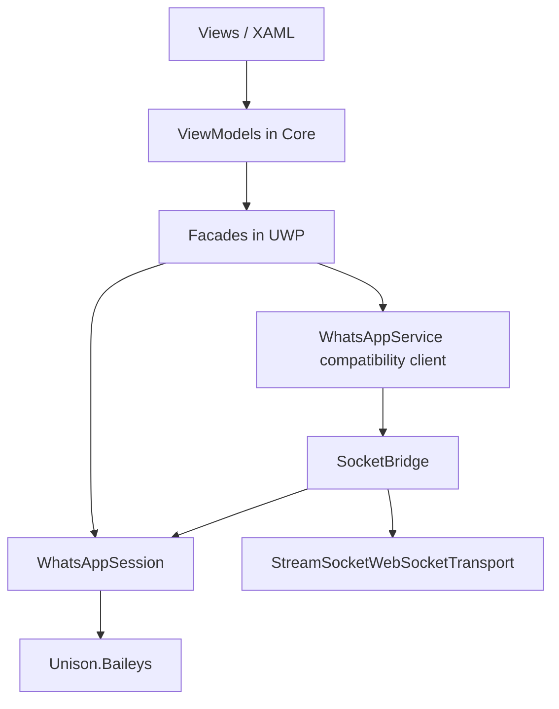
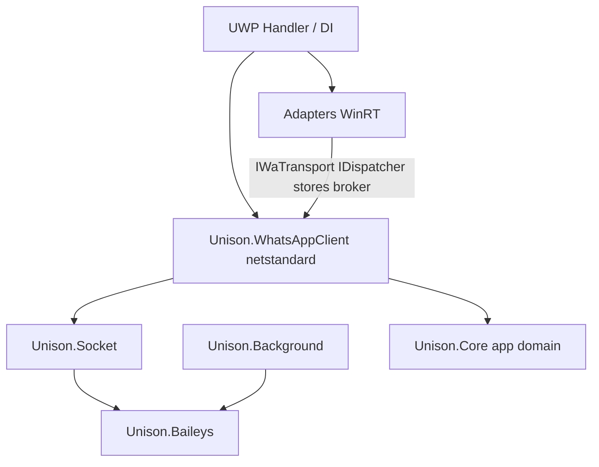
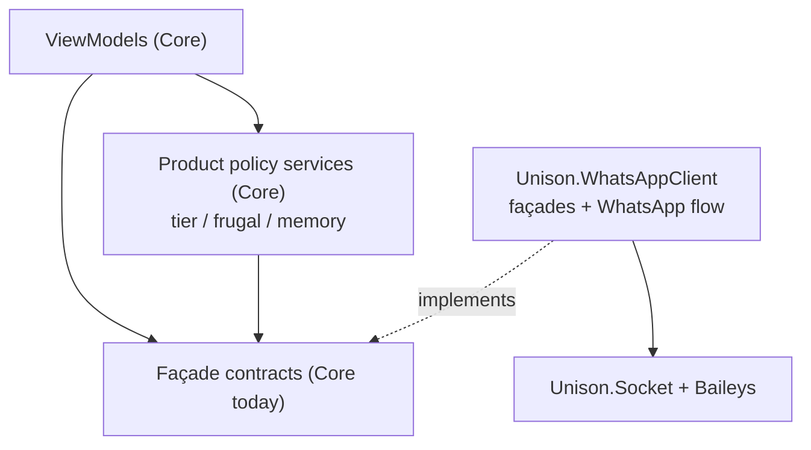

# Netstandard WhatsApp client

**Plan only.** This page describes the destination architecture and migration order. It does **not** replace [WhatsAppService extraction](WhatsAppService-Extraction): finish extracting clusters out of the compatibility client before moving types into a new project. No `src/` moves are implied by publishing this page.

Related: [Architecture](Architecture), [Application layer](Application-Layer), [Socket stack](Socket-Stack), [Background broker](Background-Broker).

---

## Name map (npm Baileys vs Unison)

`@whiskeysockets/baileys` is **one** npm package. Public entry is `makeWASocket`. Internally it mixes Socket orchestration, Utils (Noise/crypto), Signal, WABinary, WAUSync, and WAProto. Upstream also does **not** own a production chat store — an optional in-memory store binds to events; serious persistence stays in the host.

Unison split that tree into two projects. The names are easy to misread:

| Upstream Baileys | Unison project | Role |
|---|---|---|
| Crypto, Noise, binary XML, protobuf, Signal primitives, `AuthState` | **`Unison.Baileys`** | Shared leaf. No Unison project references. Used by Socket, Core, UWP, and **Background alone**. |
| `makeSocket` / `makeWASocket`, messages, groups, USync, app-state, history download, … (`Ports: rc14`) | **`Unison.Socket`** | Portable session + protocol API. This is the product surface people mean by “Baileys”. |
| App chat-list policy, UI refresh rules, SQLite/JSON persistence, People overlay | Façades + `WhatsAppService` (today in **UWP**) | Unison application layer — **not** upstream Baileys. |

Mental rename (documentation only; do not rename projects in this plan):

- `Unison.Baileys` ≈ “WA protocol primitives”
- `Unison.Socket` ≈ “Baileys” / `makeWASocket`
- New Application project ≈ TDLib-style policy API over Socket

---

## Current state



| Piece | Location | Portable? |
|---|---|---|
| Contracts (`IMessageService`, …), ViewModels, shared state helpers | `Unison.Core` | Yes (`netstandard2.0`) |
| Session, use cases, `IWaTransport` | `Unison.Socket` | Yes |
| Noise / Signal / proto | `Unison.Baileys` | Yes |
| Facades, `WhatsAppService`, `SocketBridge` | `Unison.Uwp` | No — still mixed with WinRT |
| `StreamSocket` / broker transfer | `Unison.Uwp/Transport` | No — stays behind `IWaTransport` |
| Background decode + toasts | `Unison.Background` → Baileys only | Must stay free of Core / Socket / Application |

`IWaTransport` ([`src/Unison.Socket/Abstractions/IWaTransport.cs`](../../src/Unison.Socket/Abstractions/IWaTransport.cs)) is a **behaviour port** (connect / send / close / `TransferToBrokerAsync` / `ReclaimFromBrokerAsync`), not a DTO of WinRT handles. The UWP concrete type (`StreamSocketWebSocketTransport`) keeps `StreamSocket` private. Domain code must never take `StreamSocket` in a constructor.

Platform contracts already exist in Core for several host concerns (`IDispatcher`, `ILocalSettings`, `IChatStore`, `ISocketBrokerService`, …). Gaps that still touch `Windows.*` inside façades or the client are called out in the extraction wiki and must close behind those ports before a package move.

---

## Target architecture

Style: TDLib-like — the UWP **handler** (composition root) creates WinRT adapters; a portable **Application** library receives ports and owns façades and the WhatsApp flow; protocol stays in Socket + Baileys. **Unison product decisions** (device tier, frugal mode, memory budget) sit one layer above, in Core — see [Product policy layer](#product-policy-layer-unison-vs-the-whatsapp-client).



| Stays in UWP | Moves to `Unison.WhatsAppClient` (`netstandard2.0`) | Stays in Socket / Baileys |
|---|---|---|
| XAML, shell, `App.ConfigureServices` | Facades (`ConnectionFacade`, `MessageFacade`, …) | `WhatsAppSession`, use cases, modules |
| `StreamSocketWebSocketTransport`, `MessageWebSocketTransport`, `WaTransportAdapter` | Policy helpers today under `Services/WhatsApp/` (once WinRT-free) | Noise, Signal, binary, proto |
| SQLite / file store implementations | **Domain helpers** now parked in `Unison.Core/Helpers` because they were pure (usync filing, outgoing send, incoming timeline, history decisions, group apply, …) — same package as the façades they serve | — |
| People / contacts WinRT, toasts, tiles, broker task registration | Orchestration that today still lives in `WhatsAppService` partials after extraction | — |
| Transport **factory** + broker readiness | Calls `IWaTransport.TransferToBrokerAsync` / reclaim via session — never owns `StreamSocket` | `IWaTransport` definition |

### Core vs Application (helpers)

During extraction, pure rules left UWP for `Unison.Core` only because Core was already `netstandard`. That made Core a **purity dump**, not a deliberate app-domain boundary.

Target split:

| `Unison.Core` (app domain) | `Unison.WhatsAppClient` (WhatsApp client policy) |
|---|---|
| Contracts, models, ViewModels | Facades + their auxiliary services |
| **Presentation** helpers only (`RelayCommand`, bubble/link layout, UI formatting, …) | **Domain** helpers that implement façade policy (moved out of Core) |
| ViewModels talk to façade **contracts**, not to domain helpers | Owns the rules that today sit under `Core/Helpers/Chats|Messages|Contacts|History|Groups|…` when those are client policy |

Do **not** move the entire `Helpers` tree in one dump. Move **with the owning façade** in phase C. Where a ViewModel still calls a domain helper, cut that call so the VM goes through `IMessageService` / `IChatService` / … first; then the helper can leave Core.

Baileys (+ Socket) stay the protocol stack — separate from this app-domain Core.

**Fixed decisions**

1. Do **not** merge façades into `Unison.Baileys` (Background must keep a thin leaf).
2. Do **not** merge Socket + Baileys into one project in this refactor (optional NuGet packaging / rename is a later note only).
3. Do **not** stand up a second parallel client beside `WhatsAppService` — shrink and move.
4. Inject **ports** (`IWaTransport`, factory, `IDispatcher`, stores), not WinRT types, into Application.
5. [WhatsAppService extraction](WhatsAppService-Extraction) phases 3 → 4 remain the mechanical prerequisite before moving types into `Unison.WhatsAppClient`.
6. Core keeps **presentation** helpers; **domain** helpers leave Core for Application alongside façades.
7. "Domain" above means **WhatsApp flow** (how the protocol behaves: history mapping, usync filing, receipts, catch-up sequencing). **Unison product** rules (how much / when, given tier, frugal, memory) are not client domain — they go to the product policy layer below.

### Product policy layer (Unison vs the WhatsApp client)

Goal: `Unison.WhatsAppClient` + Socket + Baileys are the **pristine** WhatsApp stack — a
Baileys-style client that any host could drive. Decisions that exist because Unison is a
Windows 10 Mobile–first product (device tier, frugal mode, Kind GIFs / 512 MB, memory
headroom, "Mobile waits longer") live in **Core**, in product services that consult the
façade **contracts** and decide what to ask the client for.



**Rules**

1. WhatsAppClient / Socket / Baileys never read `DeviceCategory`, `SyncWorkloadStrategy`,
   frugal settings, `IAppMemoryInfo` or "is Mobile". They take **neutral knobs** (options or
   per-call parameters: batch sizes, delays, quotas, enable flags) with sane defaults, and
   expose **facts** (progress, quiet, pending counts, freshness) for the layer above.
2. The product service **decides**; the client **executes**. A gate like "skip deferred
   startup maintenance in frugal mode" is a product call that chooses whether to invoke a
   façade method — not a branch inside the client.
3. Knobs that are protocol inputs (`HistoryStorageQuotaMb` in `HistorySyncConfig`,
   `InitialPreKeyUploadCount`, per-chat persist cap) stay **parameters** of the client. Their
   **values** come from the product layer.
4. Hot-path pacing (inter-chunk delays inside a running pass) is passed as an options snapshot
   when the pass starts — no per-chunk call up into Core.
5. Core stops referencing protocol types: `Unison.Core` → `Unison.Baileys` (today: 5 files,
   e.g. `ConnectionSocketSessionRequest`, `IMessageService`, `IGroupService`,
   `ISocketFacadeWireHost`) is debt to close, not a pattern to grow.

**Current leakage (Nov 2026 inventory)** — 27 files in `src/Unison.WhatsAppClient` read tier /
frugal / memory. Classify each as **knob** (becomes an option/parameter), **decision** (moves up
to a Core product service) or **fact** (stays, exposed upward):

| Area | Files | Likely class |
|---|---|---|
| Deferred startup / frugal | ~~`DeferredStartupFrugalGate`~~ → `DeferredStartupGate`, `DeferredStartupMaintenanceOwner` / `Dispatch`, `IDeferredStartupMaintenanceHost`, `StartupQuietGate`, `StartupPhaseTrace` | decision moved to `IStartupMaintenanceTuning`; gate is neutral + fact (phase trace) |
| Post-replay maintenance | `PostReplayMaintenanceGates`, `PostReplayMaintenanceDispatch` | decision |
| History FULL chain | `SilentFullHistoryChainOwner` / `Dispatch`, `ISilentFullHistoryChainHost`, `PeriodicFullHistorySafetyOwner`, `IHistoryCatchUpFinishHost`, `HistoryFacade` | knob (`MaxFullHistoryCatchUpRounds`, `AllowStagnantHistoryRepairCascade`, pacing) |
| Chats / previews | `ChatFacade` (16 refs), `ChatPreviewReconciler`, `ChatPreviewMemoryTip`, `ChatCatalogDiskPersistence`, `ChatNameRefresh` (14) | knob (batch sizes) + decision (memory-tip trim) |
| Contacts / avatars / groups | `ContactFacade` (11), `ContactNameResolver`, `ChatAvatarPolicy`, `GroupRosterPolicy`, `DeferredAvatarResolution`, `GroupFacade`, `GroupMetadataApply` | knob (fetch batch / delay, roster batch) + decision (avatar policy by tier) |
| Messages | `MessageFacade` | knob |

`SyncWorkloadStrategy` (`Core/State`, one subclass per tier: `Unsupported` / `Low` / `High`) is
already the right **product** object — it stays in Core. What changes is that the client stops
receiving it; the product layer maps it to client options.

**Phases (P — runs alongside Phase B/D, before E)**

| Step | Work | Done check |
|---|---|---|
| P0 | Freeze: no new tier / frugal / memory reads in WhatsAppClient (review rule) | New owners take knobs, not `SyncWorkloadStrategy` |
| P1 | Neutral options types on the client surface (`HistorySyncOptions`, `EnrichmentPacingOptions`, …) — numbers and flags only, no tier names | Types compile with no `DeviceCategory` |
| P2 | Swap `SyncWorkloadStrategy` injection in WhatsAppClient for those options, one façade at a time (History chain first: it was just extracted) | `rg SyncWorkloadStrategy src/Unison.WhatsAppClient` shrinks per step |
| P3 | Core product services (e.g. `ISyncProductPolicy` / `StartupProductPolicy`) own the decisions: frugal gate, startup quiet, post-replay maintenance, avatar/roster policy by tier. They read tier / frugal / memory and call façade contracts | Gates gone from `Helpers/Connection`; decisions unit-tested in `Unison.Core.Tests` without a client |
| P4 | Core contracts stop exposing Baileys types (own DTOs at the contract edge) | `Unison.Core.csproj` drops the Baileys reference |
| Exit | `rg "SyncWorkloadStrategy\|DeviceCategory\|SyncBudget\|UseFrugalSyncBudget\|IsMobile" src/Unison.WhatsAppClient src/Unison.Socket src/Unison.Baileys` returns 0. Neutral `Func<bool> preferFrugal` / `ISyncLoadMode` knobs (slice, pause) and `IAppMemoryInfo` read only for diagnostics are allowed | — |

**Progress (Nov 2026).** P1–P3 done for the client:

- Tuning contracts in `Core/Contracts/Tuning` (tier-free, primitives / `TimeSpan`): `ISyncLoadMode`, `IHistorySyncTuning`, `IEnrichmentTuning`, `IStartupMaintenanceTuning`.
- One product implementation: `Core/Product/SyncProductPolicy` (`SyncWorkloadStrategy` + live `SyncBudget.IsFrugal`), registered once in `App.ConfigureServices` behind the four contracts. Unit tests: `SyncProductPolicyTests`.
- Façades, owners and policies in WhatsAppClient take those contracts or plain values (`silentLotDelay`, `allowStagnantRepairCascade`, `rosterBuildChunkSize`, `flushDebounce`). `DeferredStartupFrugalGate` became the neutral `DeferredStartupGate` (`requireVisibleWindow` / `requireMemoryHeadroom`); post-replay quiet window and delayed bulk come from the host.
- `IHistoryService.PreferFrugalSyncBudget` removed; ViewModels read `ISyncLoadMode`.

**Coordinators (started):** `StartupMaintenanceCoordinator` and `PostReplayMaintenanceCoordinator`
in `Core/Product` own the deferred-startup gate / resolve-missing decision and the post-replay
abort + quiet/delayed-bulk knobs. Client dispatch asks the host (`DecideGate` /
`ShouldResolveMissingNames`) or calls `PostReplayMaintenanceCoordinator.ShouldAbortBeforeWork`;
`DeferredStartupGate` / `PostReplayMaintenanceGates` were removed from WhatsAppClient. Registered
in `App.ConfigureServices`. They do **not** yet drive façades end-to-end (host still owns
quiet/memory waits and notify ports) — that orchestration moves when `WhatsAppService` shrinks
(Phase D). Tests: `StartupMaintenanceCoordinatorTests`, `PostReplayMaintenanceCoordinatorTests`.

Still open: `WhatsAppService` (UWP host) reads `_workload` / `CurrentSyncPacing` / `UseFrugalSyncBudget`
directly — host debt that leaves with it (Phase D). P4 untouched. Coordinators do not yet
subscribe to façade facts or notify UI (next cheap slice when a VM still duplicates a gate).

**Dependency direction (decided):** contracts stay in Core through P (WhatsAppClient → Core),
tier-free; the flip happens in Phase E (client owns its I/O, Core → WhatsAppClient, product
services consult the client directly).

**Risk:** the History FULL chain and deferred startup are the paths Mobile is most sensitive
to. P2/P3 there need on-device runs (first sync, reconnect with stale tips, frugal on/off),
not only unit tests.

### Product coordinators (Core — next)

Do **not** name these `UseCase`. That word already means one Socket protocol operation
(`Unison.Socket/UseCases/…`). Product orchestration lives in **`Unison.Core/Product/`** as
**coordinators** (or keep `*Policy` when the type only maps knobs and never calls a façade).

```
ViewModel
  ├─ façade contract directly     when there is no Unison product decision
  └─ Product coordinator (Core)   when tier / frugal / memory / window / notify matter
        ├─ injects façade contracts (IHistoryService, IContactService, …) — never concrete façades
        ├─ injects SyncProductPolicy / tuning contracts for knobs
        ├─ may subscribe once to façade facts (singleton) and emit decided UI intents
        └─ platform work only via Core interfaces implemented in UWP
           (IUiWorkHolds, IAppMemoryInfo, toast/notify ports — Core decides, UWP executes)
```

**When a coordinator exists**

- There is a Unison-only rule: device tier, frugal mode, memory headroom, window visibility,
  when/how to notify the UI, defer/coalesce work.
- Or several ViewModels would otherwise subscribe to the same façade facts and duplicate gates.

**When it must not exist**

- Pure pass-through (VM → coordinator → façade with no decision). Call the façade contract.
- WhatsApp domain rules (dedup, JID merge, message order) stay on the façade / client.
- WinRT types never enter Core. Coordinators call Core ports; UWP adapters do toast /
  dispatcher / broker.

**Naming / DI**

- `SomethingCoordinator` in `Unison.Core.Product` (or keep `SyncProductPolicy` for pure mapping).
- Constructor DI only; register in `App.ConfigureServices`. No `Foo.Instance`.
- Unit-test against façade fakes in `Unison.Core.Tests` (no WhatsAppClient required for the
  decision).

**Suggested first coordinators (cheap-model safe order)**

| Coordinator | Owns | Leaves alone |
|---|---|---|
| `StartupMaintenanceCoordinator` | When to start deferred name/list repair; visibility + memory gates already on `IStartupMaintenanceTuning` | Incoming pump, reconnect timers |
| `PostReplayMaintenanceCoordinator` | Quiet wait + delayed bulk after offline replay (host still runs the owner until Phase D) | Pump ordering |
| (later) `HistorySyncCoordinator` | Banner / UI intents from history facts; optional when VMs stop reading raw progress | Silent FULL chain pacing already knobs — do not re-gate inside the client |
| (later) enrichment notify coordinators | Toast / list refresh after avatar/roster passes | `Func<bool> preferFrugal` UI slice knobs on client (allowed) |

Do not invent a coordinator per façade. Grow only where a product decision or a shared
subscription is real.

### Agent execution boundaries (Opus vs cheaper models)

Use this when continuing Phase P / coordinators / extraction on a **cheaper** model. The
architecture is fixed above; cheaper models implement only the rows marked **OK**. Anything
marked **Opus / human** stays out of that session unless the developer explicitly overrides.

| Work | Cheaper model | Why |
|---|---|---|
| New `*Coordinator` / extend `SyncProductPolicy` / new tuning contract members with TDD | **OK** | Pure Core; tests in `Unison.Core.Tests`; no protocol |
| Wire DI in `App.ConfigureServices`; pass tuning into façades already on knobs | **OK** | Mechanical if constructors already take the contracts |
| Move a remaining **decision** out of WhatsAppClient into tuning + host members (same pattern as deferred startup / post-replay) | **OK** with exit grep | Mirror `DeferredStartupGate` / `IStartupMaintenanceTuning`; keep values identical |
| Leave `Func<bool> preferFrugal` / `ISyncLoadMode` slice-and-pause knobs on client | **OK leave** | Accepted Exit rule; do not "fix" by inventing coordinators that only forward the bool |
| Shrink `WhatsAppService` connection-only by extracting another **Owner** that already has a host interface and no Mobile hot-path | **OK** if listed in [WhatsAppService extraction](WhatsAppService-Extraction) as next safe step | Follow owner pattern + `XDispatch`; do not invent new reconnect policy |
| P4 — drop Baileys types from Core contracts | **Opus / planned pass** | Touches contract edges (`IMessageService`, …); easy to break hosts |
| Move **incoming pump** or **auto-reconnect / health timers** off `WhatsAppService` | **Opus + on-device + explicit ask** | Mobile hot path; wiki already forbids without confirmation |
| Broker transfer / `SocketBridge` ownership / fake handoff | **Never invent** | True only when ownership moved; cold restore not wired |
| Change silent FULL / periodic FULL / catch-up finish behaviour (not just knob injection) | **Opus + on-device** | Highest Mobile risk; knobs already extracted — do not retune numbers without a device run |
| Phase E dependency flip (Core → WhatsAppClient) | **Opus / dedicated pass** | Moves every `Contracts/WhatsApp` consumer |
| Revive `SocketClient.cs` or put WinRT in Core / WhatsAppClient | **Forbidden** | Architecture hard rule |
| `ConnectionHandler` calling use cases or holding chats | **Forbidden** | Architecture hard rule |

**Cheaper-model definition of done for a coordinator PR**

1. Red-green tests for the decision in `Unison.Core.Tests` (no client).
2. `dotnet build` / `dotnet test` on `tests/Unison.Core.Tests` (ignore the three known
   pre-existing failures: `GroupAvatarFallbackJidsTests`, `HistorySyncWireOwnerTests`,
   `MessageRevocationContentTests` unless the change touches them).
3. UWP ARM Debug build when UWP files changed.
4. No new `SyncWorkloadStrategy` / `DeviceCategory` / `SyncBudget` / `UseFrugalSyncBudget`
   reads under `src/Unison.WhatsAppClient`.
5. Wiki progress line updated; Changelog only if behaviour or public seam changed.
6. After **two** failed fix attempts on the same error → stop and ask (project rule).

### UWP handler

Single composition root (today: `App.ConfigureServices`, optionally a named `UwpWhatsAppHost` later):

- `new` / resolve adapters only here (`ITransportFactory` → `StreamSocketWebSocketTransport`, stores, dispatcher attach).
- Register Application façades against Core contracts.
- No new domain policy in the handler.

### Portable persistence (SQLite / file store — plan only)

**Verdict:** yes, with the current model — same idea as TDLib (client owns the DB; host only
supplies a root path and native init). Do **not** start this until Phase D has
`WhatsAppService` connection-only and product knobs/coordinators are stable. Plan only below.

**Today**

| Piece | Where | Notes |
|---|---|---|
| Contracts `IMessageStore`, `IChatStore`, `IHistoryMessageStore`, `IPersonStore`, … | Core | Façades / client already depend on these |
| `ChatStore`, `History*Store`, `PersonStore`, `GroupRosterStore`, `CallLogStore`, … | UWP `Data/` | `sqlite-net-pcl` + `unison.db` under `ApplicationData.Current.LocalFolder` |
| `MessageStore` | UWP `Data/` | **JSON** under LocalFolder (WinRT `StorageFolder`), not SQLite |
| `SQLitePCL.Batteries.Init()` | UWP `App` | Must stay at process start (and any second process that opens the DB) |
| Background preview/broker files | `Unison.Background` | Own small stores; **must not** reference Core or WhatsAppClient |

**Target (TDLib-shaped)**

```
UWP / Background host
  → supplies dbRootPath (string) + Batteries.Init()
Unison.WhatsAppClient (or sibling Unison.Persistence netstandard2.0)
  → implements I*Store with sqlite-net-pcl / System.IO over that path
Façades
  → keep talking to I*Store only (already true)
```

Host keeps: path from `ApplicationData` (or broker local folder), PCL init, optional
file-picker / backup UI. Everything that speaks SQL or JSON schema moves behind netstandard.

**Recommended package split**

- Prefer a small **`Unison.Persistence`** (`netstandard2.0`) referenced by WhatsAppClient
  (and later by tests), **not** dumping SQL into Core. Core stays contracts + models.
- If Background ever needs the same `unison.db` schema, it may reference **only**
  Persistence (or a thinner `Unison.Persistence.Broker` slice) — never Core ViewModels /
  WhatsAppClient. Default for now: Background keeps its isolated preview stores; sharing
  the live DB from the out-of-process task is a **separate** decision (locking, schema,
  toast-only reads).

**Migration steps (when opened)**

| Step | Work | Done check |
|---|---|---|
| S0 | Inventory: every `src/Unison.Uwp/Data/*Store.cs` + Entities; classify SQLite vs JSON vs WinRT-only | Table in this page |
| S1 | Introduce `IAppDataPaths` (or ctor `string dbDirectory`) in Core contracts; UWP adapter returns `LocalFolder.Path` | Stores compile against path string, not `ApplicationData` in signatures |
| S2 | Move SQLite entities + one store (`ChatStore` or `PersonStore` — smallest) into Persistence; register from UWP | App runs; same `unison.db` |
| S3 | Move remaining SQLite history/chat/roster/call stores; keep schema versions identical | ARM device open-chat + history catch-up smoke |
| S4 | Port `MessageStore` JSON I/O from `Windows.Storage` to `System.IO` over the same root (or fold into SQLite in a later pass — do not mix goals) | Wipe / syncId rotation still works |
| S5 | Tests: Persistence project tests with temp directory (no UWP) for schema migrate + one read/write path | CI without WinRT |

**Do not**

- Put WinRT `StorageFile` / `ApplicationData` inside Persistence or WhatsAppClient.
- Open the same `unison.db` from Background without an explicit locking/WAL plan.
- Change schema “while moving” — move first, migrate schema in a dedicated change.
- Block Phase D / coordinators on this; persistence is parallel **after** connection-only host.

**Risk:** Mobile Lumia I/O + large history tables; any path or connection-string mistake
corrupts the only copy of chat history. Require on-device open-chat + first sync after S3.

**Agent boundary:** S1–S2 OK on a cheaper model (mechanical + temp-dir tests). S3–S4 need
careful review / Opus if schema or wipe/syncId behaviour is touched. Sharing DB with
Background = Opus + explicit ask.

---

## Migration phases

Do in order. Each phase has a done check.

### Phase A — Close WinRT leaks behind existing ports

- Goal: façades and remaining client code call only Core/Socket abstractions for UI thread, settings, files, connectivity where already modelled.
- Touch: façade files under `src/Unison.Uwp/Services/WhatsApp/` that still `using Windows.*` (e.g. `ContactFacade`, `ConnectionFacade`, media path helpers).
- Done when: no new WinRT types are required on the façade public surface; remaining WinRT is only in adapters/stores/transport.

**Façades (done on this branch):** `ConnectionFacade` asks `INetworkAccess` (`WinRtNetworkAccess` holds `NetworkInformation`). `ContactFacade` waits for People-card return via `IAppLifecycle.WaitUntilForegroundAsync` (no `Window` / `CoreApplication`). Façade `.cs` files under `Services/WhatsApp/**` no longer `using Windows.*`.

**Client follow-up (this branch):** `MediaAvailability` no longer `using Windows.*` — document length goes through `IMediaCache.TryGetLengthBytesAsync` (`MediaCacheService` holds `StorageFile`). Startup quiet / memory headroom and `StartupPhaseTrace` use `IAppMemoryInfo` (`WinRtAppMemoryInfo`); `SyncBudget` low-memory probe likewise. Reconnect-toast suppress uses `ILocalSettings`; `OnPropertyChanged` marshals via `AttachedUiDispatcher` (no `CoreApplication`). Dead `using Windows.*` stripped from `WhatsAppService` partials. Remaining WinRT on stores / transport / DEBUG harness / other client IO stays until Phase B (adapters).

### Phase B — Finish WhatsAppService extraction (phases 3 and 4)

- Follow [WhatsAppService-Extraction](WhatsAppService-Extraction): move remaining clusters; then connection-only client (`Initialize` / connect / resume / suspend / broker / shutdown).
- Done when: ViewModels and façades do not need the god client for policy; `IWhatsAppService` (or successor) is lifecycle + façade-only raw events; `Attach*` orchestration into the client is gone.

### Phase C — Create `Unison.WhatsAppClient`

- Add `Unison.WhatsAppClient` (`netstandard2.0`) to the solution.
- References: `Unison.Core`, `Unison.Socket` (and thus Baileys transitively as today).
- Move façades + WinRT-free policy helpers from UWP into this project.
- Move **domain** helpers from `Unison.Core/Helpers` into Application **with the owning façade**; leave presentation helpers in Core.
- Where ViewModels still import domain helpers, route through façade contracts first so Core does not need to reference Application.
- UWP keeps adapter implementations and registers them in DI.
- Done when: Application builds with **zero** `Windows.*` / WinRT; Core `Helpers` no longer hosts WhatsApp client policy; UWP still runs against the same contracts.

**Scaffold (started):** project is named **`Unison.WhatsAppClient`** (not `Unison.Application`) — under namespace `Unison.*`, an `Application` assembly name collides with XAML `Application`. In `Unison.slnx` with Core + Socket refs; UWP references it.

**Façade moves:** `ProfileFacade` → `Profiles/`. `StatusFacade` → `Status/` (thumbs via `IStatusThumbnailMaterializer`). `ChatFacade` + `ChatPreviewReconciler` → `Chats/` (pin/read/delete via `IChatAccountActions` / `BridgeChatAccountActions`). `GroupFacade` + `GroupMetadataReader` → `Groups/` (wire IQs via `IGroupWireActions` / `BridgeGroupWireActions`; avatars via `IGroupAvatarActions` / `BridgeGroupAvatarActions`). `ConnectionFacade` → `Connection/` (portable session provider + `IRuntimeDiagnostics`). `HistoryFacade` → `History/` (`IAppVisibility`, `IHistoryMessageThumbnailMaterializer` / `IStatusThumbnailMaterializer`, portable session + `IHistoryOnDemandSocket` for resync wait). `MessageFacade` → `Messages/` (presence/pin via `IMessageWireActions` / `BridgeMessageWireActions`; media via `IMediaAvailability` / `MediaAvailability`). `ContactFacade` + contact helpers → `Contacts/` (`IAvatarFetchActions` / `AvatarFetcher`, `IChatAvatarFetch` / `ChatAvatarFetch` stay in UWP). Portable `IWhatsAppSessionProvider` is in `Abstractions/`; UWP `BridgeSessionProvider` extends it with `IWhatsAppSocket`.

**Helpers:** do **not** dump the whole `Unison.Core/Helpers` tree. Domain helpers that were **only** consumed by UWP (`WhatsAppService` / façades) + tests may move into `Unison.WhatsAppClient/Helpers/{History|Chats|…}` (namespace `Unison.WhatsAppClient.Helpers`) in closed batches — Core must not reference WhatsAppClient. Helpers still used by Core ViewModels/State stay until those call sites go through façade contracts. Presentation helpers stay in Core.

**First closed batch (done on this branch):** ~91 pure policy helpers under `History|Chats|Contacts|Groups|Messages|Connection|Diagnostics` that had no Core ViewModel/State inbound refs. Call sites take `using Unison.WhatsAppClient.Helpers`. Left in Core when coupled to contracts/State (e.g. `OutgoingFailureClassification` / `OutgoingSendAttemptOutcome`, `HistoryCatchUpContinueDecision`, mappers used by VMs).

**Follow-on closed batches (done on this branch):**

| Batch | Moved into `Unison.WhatsAppClient` | Left in Core / UWP |
|---|---|---|
| Outgoing send | `OutgoingTextSend`, `OutgoingMediaSend` | Retry/settlement types (`OutgoingTextSendRetry`, …) stay in Core (contracts + tests share them) |
| Receipts | `ReceiptReader` / `ReceiptFacts` (was UWP; Attrs via `TryGetValue`) | `WhatsAppService.Receipts` still mutates ticks |
| Group apply | `GroupMetadataApply`, `GroupRosterWriter` | `GroupRosterRules` / naming blacklist stay in Core (ViewModels) |
| History builders | `HistoryMessageBuilder`, `HistoryMediaFiller` | — |
| Outgoing support | `OutgoingChatMessage`, `OutgoingDocumentKinds`, `OutgoingMessageId`, `OutgoingSendSettlement`, `MediaFileExtensions` | `OutgoingFailureClassification` / `OutgoingSendAttemptOutcome` stay in Core (contracts) |
| Chat row pick | `ChatRowAvatarLookup`, `DuplicateChatRowPick` | — |
| Quotes | `QuotedContext` | — |
| History list hydrate | `HistoryChatPreviewApplier`; `IChatService.ApplyHistoryChatPreviewHydrate` | VM only wires PropertyChanged + batch UI; `ChatPreviewNormalizer` stays in Core |
| Open-chat strip | `TimelineListStrip`, `LiveChatPreviewApplier`, `ParticipantStripIdentity`; `IChatService.SyncListStripFromTimeline` | Detail VM delegates to façade |
| Group roster rules | `GroupRosterRules`; `IGroupService.MemberMatches` / `MembershipPersonKeys` | Info pane no longer imports the helper |
| Labels / media / Status UI | `MeaningfulChatLabel`, `ChatMediaFilter`, `StatusMediaDisplay`, `StatusItemDiagnostics` | `GroupIdPlaceholder` stays in Core (community presentation); VMs use `IContactService` / `IMessageService` / `IStatusService` |
| Pin aliases / preview fallback | `ChatPinStoreKeys`, `ChatPreviewMessageFactory`; `IChatService.ApplyLocalStateAliasFallback` / `RememberPinnedUnderAliases`; `IMessageService.CopyReactionState` / `TryCreatePreviewFallback` | List batch + detail no longer import those helpers |
| Mute deadlines / delete confirm / member resolve | `ChatDeletionPrompt`; `IChatService` mute deadlines + `ConfirmAndDeleteAsync`; `IGroupService.EnrichMember` / `ResolveMemberAvatar` / `ResolveMemberDisplayName` | `ChatMuteHelper` stays in Core (`ChatItem` / `ChatLocalState`); `GroupParticipantResolver` stays (State + lookup); list-row mute flyout uses `IChatService` deadlines |
| List order / community hubs | `ChatListDisplayOrder`, `CommunityListProjector`; `IChatService.SortChatsForDisplay` / `DeduplicateChatsByCanonicalJid` / `ProjectCommunityList` | `ChatListVisibleReconcile` / `CommunityHubPresentation` stay in Core (presentation / UI collection) |
| List search | `ChatListQuery`; `IChatService.MatchesChatListQuery` | `MentionLookupBuilder` stays in Core (shared strip/search labels) |
| Mentions / load-more page | `MentionSearch`, `TimelineLoadMorePage`; `IMessageService` mention + duplicate-page APIs | `ChatMessageOrder` stays in Core (State); `ComposerMentionDraft` stays in Core (composer presentation) |
| Unread / app-state flags / preview age | `ChatUnreadTally`, `AppStateChatMutation` (+ `ChatFlagChange`), `ChatPreviewStaleness` | — |
| Chat title replace / invite-subject blacklist | `ChatNameReplacement`, `GroupNameSyncBlacklist` | — |
| Live history map / usync alias file | `HistoryLiveMessageMapper`, `UsyncAliasFiling` | — |
| History listable / render / participant | `HistorySyncContentFilter`, `MessageRenderReader` (+ `MessageRenderInfo`), `WebMessageParticipant`, `MessageKeyAltJidScan` | `ProtoMessageUnwrap` stays in Core for `ChatMessageMapper`; `MediaPreviewTag` stays (presentation) |
| History row map / list tip | `HistoryMessageMapper`, `ChatPreviewTip` | `MessageTimestampValidity` / `LegacyDeletedPreview` stay (State + `ChatPreviewNormalizer`); `ChatMessageOrder` stays (State / VMs) |
| Deep-link list UI / reorder / timeline merge | `ChatListDeepLinkSyncUi`, `ChatListNamesAppliedRefresh`, `ChatListReorderTrigger`, `ChatTimelineLiveMerge`; `IChatService` / `IMessageService` APIs | `ChatTimelineMergeMode` stays in Core; `ListEnrichmentPhase` / `SyncPhaseStatus` stay (State + list localize) |
| List hold / self identity | `ChatListSyncHold`; `IChatService.ShouldHoldChatListRows`; `IContactService.IsSelf` | `SelfIdentity` stays (GroupParticipantLookup / State) |
| List enrichment phase gate | `IChatService.MatchesListEnrichmentPhase` | `ListEnrichmentPhase` stays in Core (State + façade); presentation helpers (`ReactionsBuilder`, `ChatListVisibleReconcile`, `MediaPreviewTag`, `ComposerMentionDraft`, …) stay in Core — VMs may call them directly |
| Timeline sort / insert index | `IMessageService.SortTimelineInPlace` / `FindTimelineInsertIndex` | `ChatMessageOrder` stays in Core (State / caches still import it) |
| Open-chat participant lookup | `IGroupParticipantLookup`; `IGroupService.CreateOpenChatParticipantLookup` / `InvalidateParticipantDirectChatIndex` / context-free `EnrichMember` | Implementation `GroupParticipantLookup` still in Core (State/Info factory still build `ParticipantResolutionContext`); presentation `MessageRunLayout` takes the interface |
| Utility policy (no Core inbound) | `FirstNonBlankText`, `UserJidShape`, `MediaCacheCleanPlan` | — |

**Inventory note (Phase C — movable domain closed on this branch):** orphan utilities (`FirstNonBlankText`, `UserJidShape`, `MediaCacheCleanPlan`) and VM→façade **NEEDS_CUT**s (incl. open-chat `IGroupParticipantLookup`) are done. WhatsAppClient has **zero** `Windows.*`. What remains under `Core/Helpers` is intentional:

| Stay | Why |
|---|---|
| Presentation (`ReactionsBuilder`, `MessageRunLayout`, `ChatListVisibleReconcile`, `ComposerMentionDraft`, `CommunityHubPresentation`, camera/UI math, …) | VMs / UWP code-behind may call directly |
| KEEP_STATE (`PushNameLookup` ← `ContactDisplayNames`; `OfflineReplaySummaryMerge`; `ChatMessageOrder`; `GroupParticipantResolver` ← `ChatAuthorProjection`; `SyncPhaseStatus` / `ListEnrichmentPhase` / `SelfIdentity` / `FirstSyncUiAvatarPolicy`; …) | Core State imports them; Core must not reference WhatsAppClient |
| KEEP_CONTRACT (`OutgoingFailureClassification` / `ConnectionStabilityExperiment`) | Shared with `IOutgoingMessageHost` / send settlement |

Further shrinking those rows is **State/contract seams** (or Phase E), not another MOVE_NOW batch. Phase C’s closed-batch work is done; continue with [WhatsAppService extraction](WhatsAppService-Extraction) Phase B (clusters 3→4).

**UWP-only helpers still in Core** (`CameraOrientationMath`, `CameraPreviewCropMath`, `MessageBubbleContextGestureGate`, `MessageLinkParser`): presentation / UI math with no WhatsApp policy. Leave in Core (tests live in `Unison.Core.Tests`; Core must not grow a UWP project reference). Moving them is optional Phase D host hygiene, not Phase C.

### Phase D — UWP as host only

- UWP = XAML + adapters + DI + thin connection host if anything remains of `WhatsAppService`.
- Prefer deleting the compatibility client once ConnectionFacade + SocketBridge cover lifecycle.
- Done when: solution layout matches the target diagram; Background still references **only** `Unison.Baileys`.

**In progress (Init shape on the live path):**

| Piece | Status |
|---|---|
| `IWhatsAppTransportFactory` / `UwpWhatsAppTransportFactory` | Done — only UWP news StreamSocket / MessageWebSocket |
| `WaTransportConnectOrder` + `WaTransportConnectAttempt` | Done — host picks primary/fallback |
| `SocketBridge.ConnectWithTransportsAsync` | Done — bridge receives transports; parameterless `ConnectAsync` throws |
| `IConnectionConnectOpenHost.ConnectAssignedTransportAsync` | Done — builds attempt and calls the bridge |
| `SocketBridgeRemoteHooks` | Done — façade app-state callbacks out of `BuildSocketBridge` |
| `IAppMemoryInfo.LimitBytes` | Done — client diagnostics no longer call `MemoryManager` |
| `IWhatsAppSessionProvider` | Unchanged — live lookup via `BridgeSessionProvider` |
| `WireSocketEventHandlers` / incoming pump | Wire attach moved into `UwpConnectionSocketSessionFactory`; pump still on the client; offline-replay release body is `OfflineReplayRelease` |
| `IConnectionSocketSessionFactory` / `UwpConnectionSocketSessionFactory` | Done — build + wire + transport open leave `WhatsAppService`; portable `ConnectionConnectOpen` owns the sequence |
| DI registers concrete `WhatsAppService` | Done — host ports resolve without casting `IWhatsAppService` |
| `ConnectionOpenHost` / `IConnectionSocketAssignment` | Done — portable open host; assignment port in Core; abort/clear + key-store journal helpers in WhatsAppClient |
| Portable connection **open** end-to-end | **Done** — `ConnectionConnectOpen` + `ConnectionOpenHost`; UWP only owns `_socket` field, dispose, and health-monitor start. **Not** moved (ask before Mobile risk): incoming pump, auto-reconnect / health-monitor timers |
| `ConnectionConnectAbortedJournal` | Done — prepare-abort reason strings portable (journal only; no pump/reconnect) |

### Phase E (future) — client-owned public I/O

**Not** Phase C/D work. Long-term goal: `Unison.WhatsAppClient` publishable / reusable without dragging Unison UI models — a portable WhatsApp **policy** library whose **entry and exit** types live on the client (or a thin contracts package next to it), not on Unison.Core ViewModel-shaped models.

Until E ships, façades **keep** returning Core `Models` / `Contracts` (dependency arrow `WhatsAppClient` → `Core` stays). That is portable vs WinRT; it is **not** yet portable vs Unison’s app domain.

| Now (C/D) | Later (E) |
|---|---|
| `IMessageService.Send…` takes/returns Core `ChatMessage` / strings already in Core contracts | Client DTOs / request–response records on the client surface (`SendTextRequest`, `ChatMessageDto`, …) |
| Core ViewModels call `I*` in Core; implementation is WhatsAppClient | Core (or a host mapper) maps client I/O ↔ Core models at the composition root / thin adapter |
| One enum vocabulary in Core (`ChatPreviewKind`, …) | Client may expose its own wire-facing or policy-facing enums **only where the concept diverges**; prefer shared primitives (`string` jid, `DateTime`, status codes) over mirrored enum pairs |

**How to grow toward E without a big-bang rewrite**

1. Do **not** duplicate enums or models during C/D “because E is coming”.
2. Prefer **new** façade methods to take explicit parameter objects (still Core types today if that is what contracts use).
3. When cutting a VM → domain-helper call, put policy on the façade and leave presentation (`ChatPreviewNormalizer`) in Core — that seam is what E will map across later.
4. A dedicated E pass then: move or wrap `Contracts/WhatsApp` I/O onto the client assembly; leave Core with presentation models + mappers; WhatsAppClient drops the Core **models** reference if contracts no longer need them (Core may still be referenced for nothing, or only via an optional adapter package).

**Done when (E):** a second host can reference WhatsAppClient + Socket + Baileys and speak only client I/O types — no `Unison.Core` ViewModels/models required to call the client.

---

## Non-goals

- Immediate rename of `Unison.Baileys` → Protocol (document the mental model only).
- Passing `StreamSocket` (or other WinRT handles) into Application / façades / Socket constructors.
- A second WhatsApp client implemented in parallel with `WhatsAppService`.
- Cold restore of a broker-owned socket after process death (still not wired; see [Background broker](Background-Broker) / [Migration](Migration)).
- Merging Application into Baileys or Socket.
- **During C/D:** dual Core↔client model/enum trees for the same concept (deferred to Phase E; see above).

---

## Risks

| Risk | Why it matters |
|---|---|
| Background pulls Core/Socket/Application | Breaks the out-of-process size/isolation rule |
| Broker transfer faked or moved up the stack | `TransferToBrokerAsync` must stay on the live transport; answer true only when ownership moved |
| Dual transport interfaces (`IWhatsAppTransport` vs `IWaTransport`) | Keep the adapter; do not widen both during the move |
| Remaining `Attach*` / pump ordering | Extraction phase 3 owns these; moving packages early freezes the wrong seams |
| Premature project move with `using Windows` left in façades | Application would become UAP and lose the point of the split |

---

## Done criteria (summary)

| Phase | Testable check |
|---|---|
| A | Façade public API free of WinRT; adapters own `Windows.*` |
| B | Extraction wiki phase 4 target surface; no policy growth on `IWhatsAppService` |
| C | `Unison.WhatsAppClient` builds as `netstandard2.0` with no WinRT |
| D | UWP is host-only; Background → Baileys only (unchanged rule) |
| P | WhatsAppClient / Socket / Baileys free of tier / frugal / memory reads; product decisions in Core services over façade contracts; Core drops the Baileys reference |
| E | Client public I/O types owned by WhatsAppClient (or sibling contracts); Core maps at the host edge; second host can call client without Core UI models |

---

## After this page

Implementation work starts on a **code** branch after phase A/B progress, not by editing `src/` on the docs branch that introduced this page. Update [Architecture](Architecture) project graph when `Unison.WhatsAppClient` actually lands.
